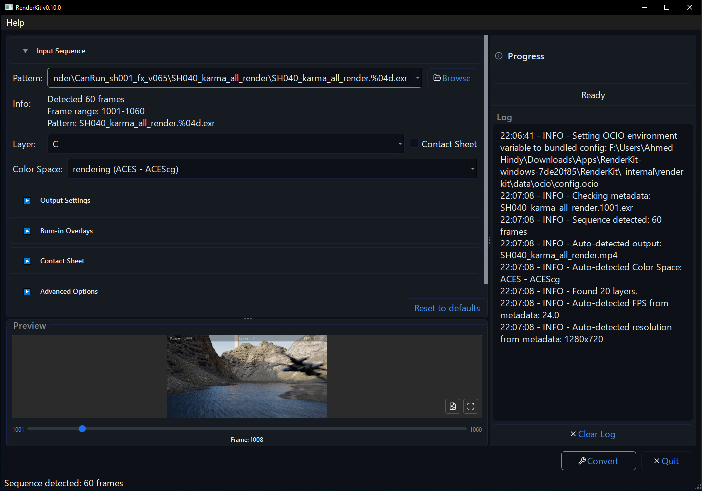

# RenderKit

[](https://opensource.org/licenses/MIT)
[](https://Ahmed-Hindy.github.io/renderkit/)

RenderKit is a VFX desktop app and CLI toolkit for turning render image sequences into reviewable MP4s and editorial MOVs.
Open a sequence, choose the review settings you need, and click **Convert**.



_RenderKit converting an image sequence to MP4._

## Get The App

1. Download the latest RenderKit archive from GitHub Releases.
2. Unzip it.
3. Run the RenderKit executable.

On Windows, this is usually:

```powershell
RenderKit\RenderKit.exe
```

## Basic Workflow

1. Open RenderKit.
2. Drop a file or folder into the window or click **Browse**.
3. Check the detected sequence, frame range, FPS, and output path.
4. Choose a layer, OCIO display/view or exposure/gamma grade, contact sheet, slate, burn-ins, watermark, or preset as needed.
5. Click **Convert**.

When the render finishes, use **Play Result** or **Open Output Folder**.

## What It Can Make

- **Delivery & Editorial Codecs**: H.264, H.265 (8-bit and 10-bit HEVC), AV1, hardware-accelerated MP4 encoders (NVENC/QSV/VideoToolbox/VAAPI), and 10/12-bit ProRes or DNxHR `.mov` outputs.
- **Color & Look Grading**: OpenColorIO (OCIO) Display/View transforms with Exposure (stops) and Gamma adjustments.
- **Review Overlays**: Intro slates, 6-zone HUD burn-ins (including `{user}`, `{frame_range}`, and `{exr:<attr>}` metadata tokens), centered or tiled watermarks, and multi-layer AOV contact sheets.
- **Presets & Automation**: Reusable JSON presets (`presets/`), recursive `batch-convert` with `--watch` folder polling, and `video-to-exr`, `transcode`, and `proxy` editorial workflows.
- **DCC Integrations**: Drop-in Houdini 21.0 ROP/Solaris/shelf scripts and Foundry Nuke `menu.py` hooks in `integrations/`.

## More Documentation

For command-line, automation, DCC setup, environment-variable, source checkout, and Python API usage, see the [usage guide](docs/usage.md) or the [full documentation](https://Ahmed-Hindy.github.io/renderkit/).
